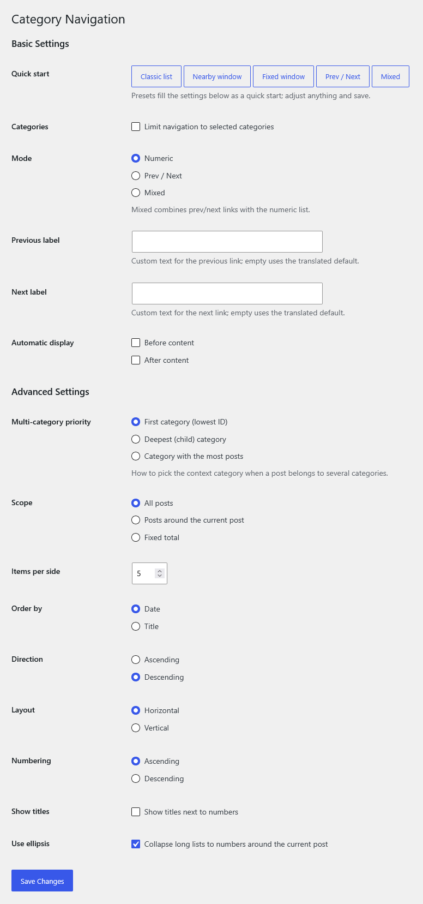
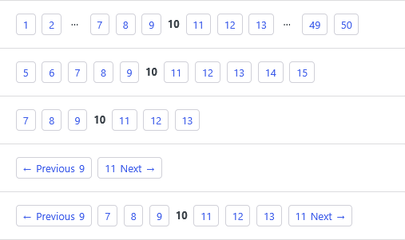

# Category Post Navigation


[](https://buymeacoffee.com/atakanau)

Numeric, prev/next and mixed navigation between published posts of the current post's category on single post views.

- **Text domain:** `category-post-navigation`
- **Stable tag:** 0.1.0

## Repository layout

| Branch / area | Contents |
|---|---|
| `main` | Plugin source code and the CSS/JS files the plugin ships with |
| `assets` | Screenshots and demo content files; never part of the installable zip |
| Releases | Installable `category-post-navigation.zip` packages, tagged `vX.Y.Z` |

## Description

Category Post Navigation helps visitors move through the posts of a category while reading. On a single post view the plugin builds a numbered list of the published posts in that category, marks the current post and links to the others.

## Features

* Four usage paths: `[category_post_navigation]` shortcode, `catpnav_the_navigation()` / `catpnav_get_navigation()` template tags, the `catpnav/navigation` Gutenberg block (also usable in block theme templates), and optional automatic display before/after the content.
* Three modes: numeric list, prev/next links, or mixed — prev/next links combined with the numeric list in one navigation.
* Three scopes: all posts of the category, a window around the current post, or a fixed-total window that shifts sideways near the edges so the item count stays constant.
* Multi-category priority: choose how the context category is picked when a post has several categories — first/lowest ID (default), deepest child category, or the category with the most posts.
* Custom previous/next labels with translatable defaults.
* Long lists collapse with an ellipsis: the first two, the last two and the three neighbours of the current post stay visible (All posts scope).
* Sorting by date or title, ascending or descending.
* Numbering direction: display numbers ascend or descend along the post list.
* Accessible markup: `nav` element, list structure, `aria-current="page"` on the active item, visible keyboard focus.
* Settings page under Settings → Post Navigation, split into Basic and Advanced sections with one-click quick-start presets and a live preview of the resulting navigation; shortcode attributes can override every setting per usage.
* Translation-ready with the `category-post-navigation` text domain; no third-party plugin dependencies.
* Two lightweight filters for developers (`catpnav_window_items`, `catpnav_navigation_html`).

Performance: the navigation runs two small queries per single post view (one ID list, one batched priming query for the rendered items) and no cache layer, so lists are always current.

## Example pagination cases

| Scenario | Output |
|---|---|
| 50-post category, "All posts" scope, ellipsis on, current post 9th, ascending numbering | `1 2 … 7 8 [9] 10 11 … 49 50` |
| Category with 8 posts — below the collapse threshold, full list | `1 2 3 [4] 5 6 7 8` |
| "Posts around the current post" scope, 5 items per side, current post 2nd | `1 [2] 3 4 5 6 7` |
| "Fixed total" scope, 7 items, current post 2nd of 50 | `1 [2] 3 4 5 6 7` |
| "Fixed total" scope, 7 items, current post 49th of 50 — window shifted, count still 7 | `44 45 46 47 48 49 [50]` |
| Mixed mode, current post in the middle | `← Previous 1 2 [3] 4 5 Next →` — neighbours omitted at the first/last post |
| Prev/next mode, current post in the middle | `← [Previous] … [Next] →` — a missing direction is omitted entirely |

`[9]` marks the emphasised current post; `…` is a single collapsed ellipsis item.

## Settings

Basic:

| Setting | Values | Default |
|---|---|---|
| Quick start | One-click presets: Classic list, Nearby window, Fixed window, Prev / Next, Mixed — they fill the fields below; layout, ordering and numbering stay untouched | — |
| Live preview | Sample-data rendering of the navigation beside the form; updates as settings change | Always on |
| Categories | "Limit navigation to selected categories" checkbox plus a multi-select; filter off or empty selection = all categories | Filter off (all categories) |
| Mode | Numeric / Prev-Next / Mixed (prev/next links plus the numeric list) | Numeric |
| Previous / Next label | Custom text for the prev/next links; empty = translated default ("Previous" / "Next"); effective in Prev-Next and Mixed modes | Empty (translated default) |
| Automatic display | Independent "Before content" / "After content" checkboxes | Both off |

Advanced:

| Setting | Values | Default |
|---|---|---|
| Multi-category priority | First (lowest ID) / Deepest (child) category / Category with the most posts | First (lowest ID) |
| Scope | All posts / Posts around the current post / Fixed total | All posts |
| Items per side | 1–20; per-side count for "around", total item count for "fixed" | 5 |
| Order by / Direction | Date / Title; Ascending / Descending | Date, Descending (newest post first) |
| Layout | Horizontal / Vertical | Horizontal |
| Numbering | Ascending / Descending | Ascending (1 = first post in the list) |
| Show titles | Checkbox | Off |
| Use ellipsis | Checkbox, effective in the "All posts" scope only | On |

## Shortcode attributes

Every setting can be overridden per usage; unknown or invalid attributes fall back to the settings:

```
[category_post_navigation category="news-and-updates" mode="mixed" scope="fixed" around="9" orderby="date" order="ASC" numbering="descending" show_title="false" ellipsis="false" layout="vertical" multi_cat="deepest" prev="Back" next="Forward"]
```

* `category` — category slug or term ID.
* `scope` — `all`, `around` or `fixed`; `around` — 1–20.
* `mode` — `numeric`, `prevnext` or `mixed`; `layout` — `horizontal` or `vertical`; `numbering` — `ascending` or `descending`.
* `orderby` — `date` or `title`; `order` — `ASC` or `DESC`.
* `show_title` / `ellipsis` — `true` or `false`.
* `multi_cat` — `first`, `deepest` or `most_posts`.
* `prev` / `next` — custom previous/next link text.

The template tags accept the same keys, e.g. `catpnav_the_navigation(['mode' => 'mixed', 'prev' => 'Back'])`.

## Gutenberg block

The `catpnav/navigation` block renders the same navigation as the shortcode and the template tags, through the very same renderer. Insert it into post content or, in block themes, directly into templates with the Site Editor.

* Sidebar overrides: category (populated from the site's categories), display mode (numeric, prev/next, mixed) and window (all posts, nearby window, fixed total with 1–20 items). Every control starts at "Use settings default"; set values apply to that block instance only, and multiple instances can carry different overrides.
* Live preview: the editor renders the block server-side, exactly like the front end. Where no single-post context exists (for example in the Site Editor), a placeholder explains what the block needs instead of showing a broken preview.

## Installation

1. Download the latest `category-post-navigation.zip` from the [Releases](https://github.com/atakanau/category-post-navigation/releases) page — every `vX.Y.Z` release tag ships a ready-to-install zip.
2. In WordPress go to Plugins → Add New → Upload Plugin, select the downloaded zip, then install and activate the plugin.
3. Open Settings → Post Navigation and choose your defaults.
4. Use the `[category_post_navigation]` shortcode in post content, place `catpnav_the_navigation()` in a template, insert the `catpnav/navigation` block, or enable automatic display.

Developers can alternatively clone the `main` branch into `/wp-content/plugins/category-post-navigation/`.

## Frequently Asked Questions

### My post has more than one category. Which one is used?

The "Multi-category priority" setting (Advanced) decides. First category (lowest ID): the post's categories are ordered by term ID (ascending) and the lowest wins — this is the original rule and stays the default. Deepest (child) category: the most specific child category wins. Category with the most posts: the largest category wins. Ties always resolve to the lowest term ID, and the "Categories" filter still restricts the candidates; if none qualifies, the navigation stays hidden.

### Will the numbering update when I add, delete or move posts?

Yes. The list is built live on every single post view; there is no cache to clear.

### How do I keep the list short on very large categories?

Keep the ellipsis setting on (default). With the "All posts" scope, only the first two, the last two and the three neighbours of the current post are rendered; everything between collapses into a single "…" item. Alternatively use the "Posts around" or "Fixed total" scope, which are limited by the "Items per side" value.

### What does the "Fixed total" scope do?

The window always shows the same number of items: the "Items per side" value, interpreted as the total in this scope. While the current post moves through the list, the window shifts sideways near the start and the end instead of shrinking, so the navigation keeps its size on every post.

### What does descending numbering do?

With the default ascending numbering the first post in the list shows number 1. With descending numbering the numbers run the other way: the first post in the list shows the total count and the last post shows 1, which is handy when a series is sorted newest-first but should be numbered from its first part.

### What happens with one or zero posts in a category?

Nothing is printed. The navigation needs at least two published posts to be useful.

### How do I remove shortcode leftovers from posts?

Deactivating the plugin keeps your settings; uninstalling removes them. Shortcode text left in post content stays as plain text — remove it with the editor.

### Can developers change the output?

Two lightweight filters:

* `catpnav_window_items` — the computed window items before rendering; receives `array $items, array $cfg` and must return an array of items.
* `catpnav_navigation_html` — the final HTML string; receives `string $html, array $items, array $cfg` and must return a string.

## Screenshots

1. 

   *Settings screen with quick-start presets, category filter, mode and label fields, automatic display checkboxes and the live preview pane.*
2. 

   *Live previews of the navigation in the numeric, prev/next and mixed modes.*

## Demo content

Install and activate the [Quick Demo Importer](https://github.com/atakanau/quick-demo-importer) plugin, then:

1. Download the `assets` branch: `git clone --depth 1 -b assets https://github.com/atakanau/category-post-navigation.git`
2. Copy the `cpn-test-demo` folder inside it (contains `config.json` and `content.xml`) into `wp-content/plugins/quick-demo-importer/demos/`.
3. Go to Tools → Demo Importer, make sure the WordPress Importer is ready (the admin UI offers to install it), select the demo profile and click **Start Import**.

## Changelog

### 0.1.0

* First release: shortcode, template tags, automatic display, numeric, prev/next and mixed modes, all/around/fixed scopes, ellipsis, ascending/descending numbering, multi-category priority, custom prev/next labels, quick-start presets, live settings preview, Basic/Advanced settings screen, lightweight developer filters, Settings link on the Plugins screen, uninstall cleanup.
* `catpnav/navigation` Gutenberg block: live server-side preview in the editor, per-block overrides for category, mode and window with clean settings fallback, a placeholder preview where no post context exists, and block theme (FSE) support.
* Editor and block placeholder strings and Turkish translations; wider responsive column for the settings screen live preview pane.
